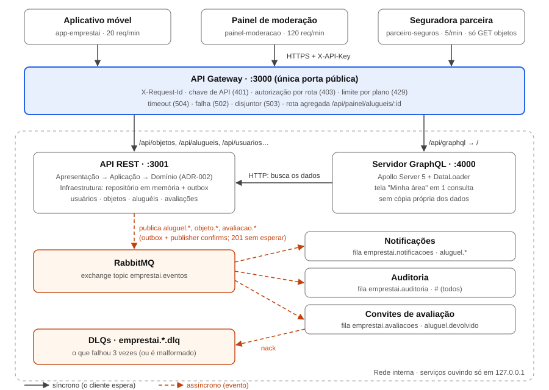

# Relatório técnico dos tutoriais — Emprestaí

**Disciplina:** Modelagem de Padrões de Projeto · **Grupo:** Isabella Mozzer, João Gabriel, Livia Ayumi, Luis Felipe e Mariana Melendez · **Data:** 16/11/2026

## 1. Tema e núcleo implementado

O Emprestaí é um marketplace de economia compartilhada para empréstimo e aluguel temporário de objetos entre pessoas. O usuário anuncia objetos, procura itens, solicita um aluguel, combina retirada e devolução e, no fim, avalia a outra parte. A diferença em relação a um marketplace de venda é o **tempo**: o mesmo objeto é emprestado várias vezes, e o sistema precisa garantir que dois aluguéis não ocupem o mesmo período e que cada etapa (aprovação, retirada, devolução) seja feita por quem tem o direito de fazê-la.

O núcleo implementado é o **ciclo de vida do aluguel**, com quatro recursos: usuários, objetos (anúncios), aluguéis e avaliações. Ficaram fora do protótipo o chat, o pagamento e a localização. O serviço externo de notificações do C4 é simulado pelo consumidor de notificações.

**Regras de negócio próprias do tema** (todas na Camada de Domínio, `rest/dominio/regras.js`):

| # | Regra | Código |
|---|---|---|
| R1 | A retirada não pode ser em data passada | 422 `data-no-passado` |
| R2 | O período não pode passar do máximo de dias definido pelo dono (`maxDias`) | 422 `periodo-acima-do-limite` |
| R3 | Ninguém aluga o próprio objeto | 422 `aluguel-do-proprio-objeto` |
| R4 | Anúncio pausado não recebe solicitações | 422 `objeto-indisponivel` |
| R5 | O objeto não pode ter dois aluguéis ativos no mesmo período | 409 `periodo-ocupado` |
| R6 | O status só segue a máquina de estados (ex.: não se devolve o que não foi retirado) | 409 `transicao-invalida` |
| R7 | Só o dono aprova, recusa e registra retirada e devolução; só o locatário cancela uma solicitação | 403 `acao-nao-permitida` |
| R8 | Anúncio com aluguel em andamento não pode ser removido nem pausado | 409 `objeto-com-aluguel-ativo` |
| R9 | Avaliação só depois da devolução, só pelas partes e uma vez por pessoa | 422 / 403 / 409 |

## 2. Diagrama da arquitetura



Linhas cheias são chamadas síncronas (HTTP, o cliente espera). Linhas tracejadas são assíncronas: a API responde 201 antes de os consumidores agirem.

## 3. Relação com a documentação do semestre

| Documento da oficina | O que foi projetado | Onde aparece no código | O que mudou e por quê |
|---|---|---|---|
| **C4 Nível 1** (Oficina 1) | Usuário; Emprestaí; sistemas externos de Pagamento, Localização e Notificações | Atores viraram **clientes do gateway**. As notificações viraram o **consumidor de notificações** com um serviço externo simulado (`mensageria/servico-notificacoes.js`) | Pagamento e Localização ficaram fora do núcleo. A notificação, que no C4 era uma chamada síncrona do backend, passou a ser **reação a um evento**: se o serviço de avisos cair, o aluguel não deixa de ser criado |
| **C4 Nível 2** (Oficina 1) | App React Native → API Node.js/Express (HTTPS/REST) → PostgreSQL; API → serviços externos | A API Node.js/Express é a `rest/` | Apareceram quatro contêineres que o C4 não tinha: **API Gateway**, **servidor GraphQL**, **RabbitMQ** e **consumidores**. O app não fala mais direto com a API: passa pelo gateway. O C4 Nível 2 deve ser atualizado com eles |
| **ADR-001: PostgreSQL** (Oficina 1) | Banco relacional pelas relações usuário–objeto–aluguel–avaliação | `rest/infraestrutura/repositorio-memoria.js` | No protótipo os dados ficam **em memória**, atrás da mesma interface de repositório. A decisão continua válida para produção: a regra de período ocupado (R5) e a outbox dependem de transação, que o PostgreSQL oferece. Status sugerido: *Aceito, implementação adiada* |
| **Pontos de acoplamento** (Oficina 2) | App ↔ API, API ↔ banco, API ↔ serviços externos | Gateway, repositório injetado e eventos | Os três acoplamentos foram reduzidos: o **gateway** isola o app das mudanças internas (reescrita de caminho e `Location`); o **repositório injetado** isola o banco; os **eventos** tiram os serviços externos do caminho síncrono |
| **Camadas** (Oficina 2) | Apresentação → Aplicação → Domínio → Infraestrutura | `rest/apresentacao`, `rest/aplicacao`, `rest/dominio`, `rest/infraestrutura` | A Camada de Apresentação do documento era o app React Native; no backend, ela virou as **rotas HTTP** (o app é um cliente externo) |
| **ADR-002: camadas fechadas** e **regra verificável** (Oficina 2) | "Apresentação não acessa o banco"; "Domínio não depende do PostgreSQL" | `testes/unitarios/arquitetura.test.js` | A regra virou **teste automatizado**: o `npm test` lê os `import` e falha se a Apresentação importar Domínio ou Infraestrutura, ou se o Domínio importar algum driver. Para o Domínio não depender da Infraestrutura, a Aplicação recebe o repositório e o publicador **por injeção** (montados em `rest/app.js`) |

## 4. Tabela de decisões

| Tecnologia | Por que está no Emprestaí | O que aconteceria sem ela | Alternativa considerada | O que se perde com a escolha |
|---|---|---|---|---|
| **API REST** | Recursos naturais do domínio (objetos, aluguéis) com operações CRUD, cache HTTP e contrato simples para o app e parceiros; dona única das regras R1–R9 | Cada cliente precisaria de um protocolo próprio e as regras ficariam espalhadas | RPC/gRPC (mais eficiente, porém pior no navegador e para parceiros) | Telas que juntam muitos recursos precisam de várias chamadas (resolvido pelo GraphQL e pela rota agregada); versionamento manual |
| **Mensageria (RabbitMQ)** | Um aluguel muda de status e várias partes precisam reagir (avisar a outra pessoa, auditar, abrir avaliações) sem atrasar a resposta | A API chamaria cada serviço de forma síncrona: se o serviço de notificações caísse, ninguém conseguiria solicitar aluguel; cada reação nova exigiria mudar a API | Chamadas HTTP diretas; Kafka (melhor para reprocessar histórico, mais pesado de operar) | **Consistência eventual** (o aviso chega segundos depois); complexidade operacional (broker, DLQ, idempotência); depuração mais difícil, o que exigiu o `X-Request-Id` no evento |
| **GraphQL** | A tela "Minha área" do app junta usuário, reputação, aluguéis, objetos e donos: com REST seriam 11 chamadas pela rede móvel | O app faria várias idas e voltas (lento em 4G) ou a API ganharia endpoints sob medida para cada tela | Endpoints BFF por tela; mais rotas agregadas no gateway | Cache HTTP por URL não funciona (tudo é POST); risco de consultas abusivas (sem limite de profundidade no protótipo); mais um serviço para operar |
| **API Gateway** | Três atores com planos diferentes (app, painel, parceiro) e serviços internos que não devem ser expostos | Cada serviço repetiria autenticação, limite e logs; o parceiro teria acesso a tudo; o app conheceria endereços internos | Autenticação em cada serviço; produto pronto (Kong, NGINX, AWS API Gateway) | **Ponto único de falha** e de gargalo; latência extra; risco de virar "lógica de negócio no gateway" (a rota agregada é o limite) |

## 5. Cenário ponta a ponta: "solicitar o aluguel da furadeira"

1. O app de Bruno envia `POST /api/alugueis` com `X-API-Key: chave-app-emprestai-123`. O **gateway** gera o `X-Request-Id` (ex.: `f3f7ec57-…`), autentica (`app-emprestai`), confere o limite (20/min) e encaminha para `http://127.0.0.1:3001/alugueis` com `x-request-id` e `x-cliente-id`. A chave do cliente não segue adiante.
   `[gateway] f3f7ec57-… POST /api/alugueis -> 201 (7 ms) cliente=app-emprestai`
2. A **API REST** valida o corpo, aplica R1 a R5, grava o aluguel e, no mesmo passo, registra `aluguel.solicitado` na outbox. Responde **201** com `Location: /alugueis/6`, que o gateway reescreve para `/api/alugueis/6`.
   `[rest] f3f7ec57-… evento aluguel.solicitado registrado na outbox` · `[rest] f3f7ec57-… POST /alugueis -> 201`
3. O laço da **outbox** publica na exchange `emprestai.eventos` com chave `aluguel.solicitado`, `messageId` igual ao id do evento e o cabeçalho `x-request-id`.
   `[outbox] f3f7ec57-… publicado aluguel.solicitado (evento 9c1e…)`
4. A exchange `topic` entrega uma cópia para `emprestai.notificacoes` (`aluguel.*`) e outra para `emprestai.auditoria` (`#`). `emprestai.avaliacoes` (`aluguel.devolvido`) não recebe.
   `[notificacoes] f3f7ec57-… aluguel.solicitado notificação enviada a Ana Souza …` · `[auditoria] f3f7ec57-… aluguel.solicitado registrado na trilha de auditoria`
5. Ana aprova (`PATCH /api/alugueis/6` com `{"status":"APROVADO","usuarioId":1}`), e o fluxo se repete com `aluguel.aprovado`. Se o locatário fosse o Diego (DDD 00), a notificação falharia 3 vezes e iria para `emprestai.notificacoes.dlq`, sem afetar a auditoria, que tem a própria fila.

### Evidências (saídas reais dos scripts de `tutoriais/testes/`)

**API REST pelo gateway** (`npm run cliente`):

```
POST /objetos  -> 201  Location: /api/objetos/7
POST /alugueis -> 201  Location: /api/alugueis/6
POST /alugueis -> 409  Período já reservado: O objeto já tem o aluguel 6 (SOLICITADO) entre 2026-11-18 e 2026-11-19.
POST /alugueis -> 422  Data de retirada no passado: A retirada (2026-11-13) não pode ser anterior a hoje (2026-11-15).
POST /alugueis -> 422  Período acima do limite do anunciante: ... no máximo 4 dia(s); foram pedidos 11.
PATCH /alugueis/6 -> 403  Ação não permitida: Só o anunciante pode mudar este aluguel para APROVADO.
DELETE /objetos/7 -> 409  Objeto com aluguel em andamento ... o aluguel 6 está SOLICITADO.
```

**O mesmo `X-Request-Id` no gateway e na API, e o evento registrado na outbox:**

```
[gateway] b00c902b-... POST /api/alugueis -> 201 (7 ms) cliente=painel-moderacao
[rest]    b00c902b-... evento aluguel.solicitado registrado na outbox
[rest]    b00c902b-... POST /alugueis -> 201 (2 ms) cliente=painel-moderacao
```

**GraphQL** (`npm run teste-graphql`): uma consulta no lugar de 11 chamadas REST, e o id seguindo até a API.

```
[gateway] 59e682f5-... POST /api/graphql -> 200 (110 ms) cliente=app-emprestai
[graphql] 59e682f5-... operação MinhaArea -> 9 chamada(s) REST (seriam 11 sem DataLoader)
[rest]    59e682f5-... GET /usuarios/1 -> 200
[rest]    59e682f5-... GET /alugueis?locatarioId=1&ordenar=dataInicio&limite=50&pagina=1 -> 200
```

**Gateway** (`npm run teste-gateway`, `-- falha`, `-- recuperacao` e `-- parcial`):

```
401  GET /api/objetos sem chave
403  GET /api/alugueis com a chave do parceiro
504  GET /api/objetos?atraso=5000                  2018 ms
429  GET /api/objetos #6 (parceiro)                retry-after=60
502  GET /api/objetos #1, #2, #3 (API REST desligada)
503  GET /api/objetos #4                    2 ms   retry-after=10   (disjuntor aberto)
200  GET /api/objetos (API religada, disjuntor fechou)
200  GET /api/painel/alugueis/2 (GraphQL desligado)   "parcial": true
```

**Mensageria** (cenas 3 e 4 do README): os logs `[notificacoes]`, `[auditoria]` e `[avaliacoes]` com o mesmo `X-Request-Id` e a fila `emprestai.notificacoes.dlq` no painel do RabbitMQ aparecem ao vivo na apresentação, com `npm run teste-evento`, `npm run teste-falha`, `npm run dlq` e `npm run teste-duplicado`.

## 6. Riscos e limitações do protótipo

| # | Risco ou limitação | Efeito | O que seria feito em produção |
|---|---|---|---|
| 1 | **Dados em memória** (API, outbox, limite de uso, disjuntor) | Reiniciar perde tudo; não dá para ter duas cópias de nenhum serviço | PostgreSQL (ADR-001) com a outbox numa tabela da mesma transação; Redis para os contadores de limite compartilhados entre cópias do gateway |
| 2 | **Gateway como ponto único de falha** | Se o processo cair, nada funciona | Várias cópias atrás de um balanceador, com verificação de saúde (`/saude`) e um produto pronto (Kong, NGINX) |
| 3 | **Identidade sem verificação**: o serviço confia no `X-Cliente-Id`, e o `usuarioId` vai no corpo | Quem alcançar a rede interna pode se passar por outro cliente ou usuário | Login com JWT/OpenID Connect validado no gateway; o usuário vem do token, nunca do corpo; mTLS entre gateway e serviços |
| 4 | **Consistência eventual** | O aviso chega depois do 201; o app pode mostrar um status desatualizado por alguns segundos | Assumido pelo negócio; o app consulta o status pela API, que é a fonte da verdade |
| 5 | **Idempotência em arquivo local** e outbox em memória | Duas réplicas de um consumidor não compartilham o registro de processadas | Tabela `mensagens_processadas` com chave única no `messageId` |
| 6 | **Corrida na regra R5** | Com várias cópias da API, dois pedidos simultâneos poderiam reservar o mesmo período | Restrição de exclusão no PostgreSQL (`EXCLUDE USING gist` sobre o intervalo de datas) ou bloqueio pessimista |
| 7 | **Dados pessoais no evento** (telefone e e-mail viajam para os consumidores) | Exposição desnecessária (LGPD) | Evento só com ids; o consumidor de notificações busca o contato num serviço próprio |
| 8 | **GraphQL sem limite de profundidade/custo** | Consultas aninhadas podem sobrecarregar a API REST | `graphql-depth-limit`, análise de custo e *persisted queries* |

## 7. Divisão do trabalho

| Parte | Responsável principal | Apoio |
|---|---|---|
| 1. API REST | Luis Felipe | Isabella Mozzer |
| 2. Mensageria | Isabella Mozzer | Luis Felipe |
| 3. GraphQL | Luis Felipe | João Gabriel |
| 4. API Gateway | Isabella Mozzer | Mariana Melendez |
| 5. Integração, relatório e decisões | João Gabriel | Livia Ayumi |
| Documentação do semestre e índice | Livia Ayumi | Mariana Melendez |
| Slides, roteiro e vídeo de reserva | Mariana Melendez | João Gabriel |

## 8. Uso de IA

Ferramenta: Claude (Anthropic), usado como assistente de programação para gerar o rascunho do código das quatro partes a partir dos tutoriais da disciplina e dos documentos das oficinas, os scripts de demonstração e o primeiro rascunho deste relatório, do README e dos slides. O grupo revisou, executou e testou o código, e responde por ele na arguição.

## 9. Referências

FIELDING, R. T. **Architectural Styles and the Design of Network-based Software Architectures**. 2000. Tese (Doutorado em Ciência da Informação e Computação) – University of California, Irvine, 2000.

HOHPE, G.; WOOLF, B. **Enterprise Integration Patterns**: designing, building, and deploying messaging solutions. Boston: Addison-Wesley, 2003.

NOTTINGHAM, M.; WILDE, E.; DALAL, S. **RFC 9457**: Problem Details for HTTP APIs. [S. l.]: IETF, 2023. Disponível em: https://www.rfc-editor.org/rfc/rfc9457. Acesso em: 15 nov. 2026.

NYGARD, M. T. **Release It!**: design and deploy production-ready software. 2. ed. Raleigh: Pragmatic Bookshelf, 2018.

RICHARDSON, C. **Microservices Patterns**: with examples in Java. Shelter Island: Manning, 2018.

BROWN, S. **The C4 model for visualising software architecture**. [S. l.], 2024. Disponível em: https://c4model.com. Acesso em: 15 nov. 2026.

RABBITMQ. **RabbitMQ Documentation**. [S. l.], 2026. Disponível em: https://www.rabbitmq.com/docs. Acesso em: 15 nov. 2026.

APOLLO GRAPHQL. **Apollo Server Documentation**. [S. l.], 2026. Disponível em: https://www.apollographql.com/docs/apollo-server. Acesso em: 15 nov. 2026.

OWASP FOUNDATION. **OWASP API Security Top 10**. [S. l.], 2023. Disponível em: https://owasp.org/API-Security/. Acesso em: 15 nov. 2026.
